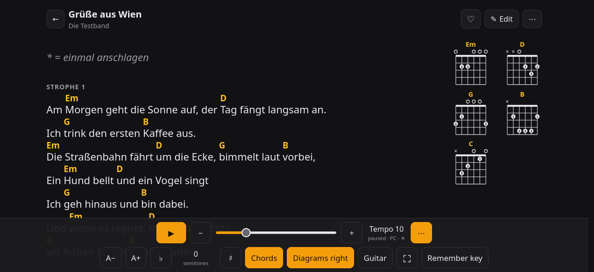
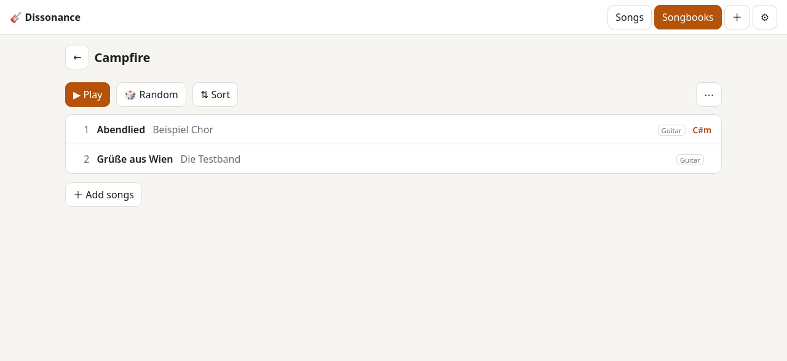

# Dissonance

**A self-hosted online songbook for playing guitar or ukulele with friends** – at the campfire, in a rehearsal room or
on the couch.

| Play mode | Songbook |
|---|---|
|  |  |

## What it is

Dissonance keeps your songs as plain [ChordPro](https://www.chordpro.org/) text files on your own server and shows
them the way you need them while playing:

- chords above the lyrics, chord diagrams for guitar or ukulele, transposition, German (H) or international chord names
- auto-scroll with a tempo per song and device, screen stays on, page-turner keys, a tuner
- import from Ultimate Guitar, Ukulele-Tabs.com, ChordPro files or "chords over lyrics" text
- songbooks you can play in order, print on A4 or as a folded A5 booklet, and export
- an editor with live preview and a full version history
- optional users via your own login provider (OpenID Connect): private songs, share links, collaboration
- installable as an app on phones and tablets, works offline, English and German, light and dark

**Built on:** the [ChordPro](https://www.chordpro.org/) file format and its chord tables, Python (standard library plus
the [Waitress](https://docs.pylonsproject.org/projects/waitress/) web server), SQLite for history and songbooks, and a
single HTML page without a build step. One small container, no database server.

> **Made with an LLM.** Dissonance was programmed with the help of a large language model (Anthropic's Claude):
> the code, tests and documentation were written in conversation with the model, and directed, reviewed and tested by
> the maintainer. An extensive test suite (unit and browser tests) checks every change.

## Deployment

### Supported architectures

The image `ghcr.io/wildermann/dissonance` is a multi-arch image – pulling it gets the right one for your machine.

| Architecture | Available |
|---|---|
| x86-64 (`amd64`) | ✅ |
| arm64 (`aarch64`, e.g. Raspberry Pi 4/5) | ✅ |

### Tags

| Tag | Meaning |
|---|---|
| `1` | newest 1.x release – recommended |
| `1.0` | newest 1.0.x (bug fixes only) |
| `1.0.0` | exactly this release |
| `latest` | newest release, also across major versions |

### docker-compose (recommended)

```yaml
services:
  dissonance:
    image: ghcr.io/wildermann/dissonance:1
    container_name: dissonance
    read_only: true
    cap_drop: [ALL]
    environment:
      - TZ=Europe/Berlin
      # - PUBLIC_URL=https://songs.example.com   # needed for login and secure cookies
      # - REQUIRE_DB=on                          # after the first start
    volumes:
      - /path/to/dissonance/songs:/songs
    ports:
      - 8080:8080
    restart: unless-stopped
```

A commented example with all common options is in [`docker-compose.yml`](docker-compose.yml).

### docker cli

```bash
docker run -d \
  --name=dissonance \
  --read-only --cap-drop ALL \
  -e TZ=Europe/Berlin \
  -p 8080:8080 \
  -v /path/to/dissonance/songs:/songs \
  --restart unless-stopped \
  ghcr.io/wildermann/dissonance:1
```

### Parameters

| Parameter | Function |
|---|---|
| `-p 8080:8080` | Web interface. Put it behind a reverse proxy with HTTPS for phones (app install, screen stays on, login) |
| `-v /songs` | Songs (`.cho` files) and the database (history, songbooks, users) – back this folder up |
| `-e TZ=Europe/Berlin` | Time zone for timestamps |
| `-e PUBLIC_URL=https://…` | Address users open; required for login |
| `-e REQUIRE_DB=on` | Never create a new database: refuse to start if the songs folder is not mounted (set after the first start) |
| `-e GUEST_ACCESS=off` | With login: people who are not signed in see only the sign-in page (for servers on the internet) |
| `-e TRUSTED_PROXY=*` | Take the client address from `X-Forwarded-For` (only when the proxy is the only way in) |
| `-e OIDC_ISSUER=…` | Turns on login via your OpenID Connect provider – see [users and login](docs/users-and-login.md) |
| `--read-only`, `--cap-drop ALL` | Recommended: the app only writes into `/songs` and needs no capabilities |

All settings: [configuration](docs/configuration.md).

### User / group

The container runs as uid/gid **1000**. The songs folder must be writable by it (`sudo chown 1000:1000 songs`).
To use another user, set `user: "1001:1001"` (compose) or `--user 1001:1001` and give that user the folder.

### Application setup

Open `http://<server>:8080`, click **＋** and write or import your first song. Without `OIDC_ISSUER` there is no
login and **everybody who can reach the app may edit** – fine for your own network; for anything else set up a login
and HTTPS ([installation](docs/installation.md)). Existing `.cho` files copied into the songs folder are picked up
automatically.

### Updating

```bash
docker compose pull && docker compose up -d
```

The database is upgraded automatically; back up the songs folder first. What changed: [changelog](CHANGELOG.md).

## Documentation

**[All features, configuration, usage and development → docs/index.md](docs/index.md)**

## License

[GPL-3.0](LICENSE). `chords.json` contains chord definitions from [ChordPro](https://www.chordpro.org)
(Artistic License 2.0).
