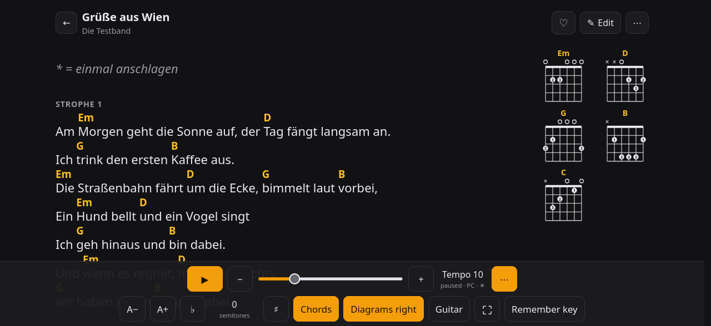
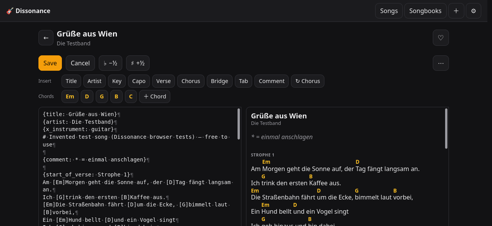
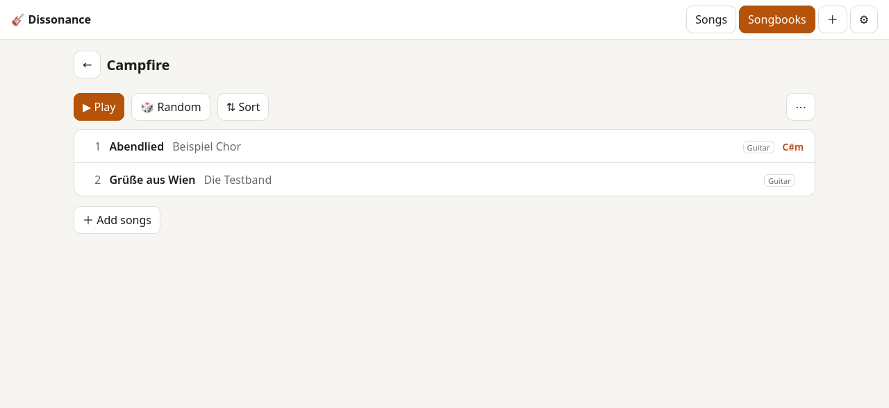
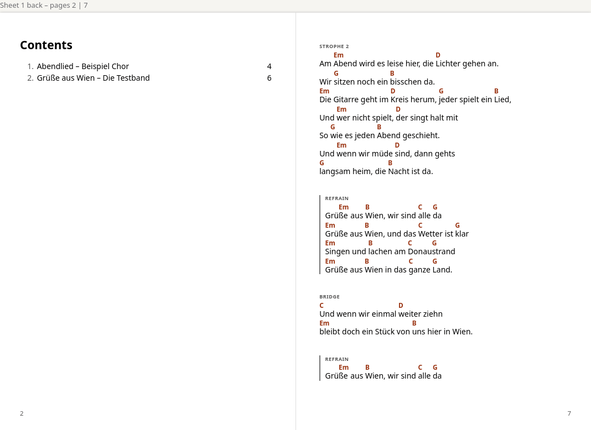
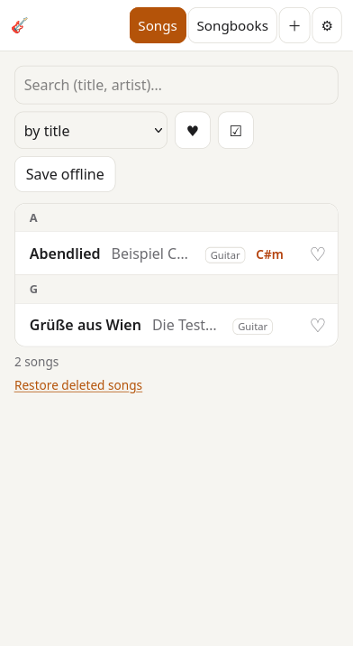
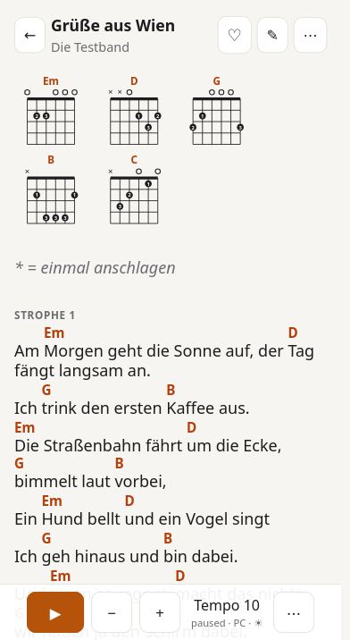

# Features

[← Documentation](index.md)

| Play mode (dark) | Editor |
|---|---|
|  |  |
| **Songbook** | **A5 booklet print** |
|  |  |

## Why Dissonance?

- **Your songs, your server.** Songs are ordinary `.cho` text files in one folder – readable without the app, easy to back
  up, sync or edit with any editor. No account at a chord site, no ads, no tracking.
- **Made for playing, not for browsing.** Big, readable chords, auto-scroll with a tempo per song and device, the screen
  stays on, works offline once loaded, installable as an app on phones and tablets.
- **From the internet to your songbook in seconds.** Paste a link from Ultimate Guitar or Ukulele-Tabs.com, upload ChordPro
  files or paste "chords over lyrics" text – it is converted to clean ChordPro.
- **Songbooks you can print.** Pick songs, order them, print them on A4 or as an A5 booklet (correct page order for
  double-sided printing and folding), export as ChordPro or ZIP.
- **Share with friends.** Optional login through your own identity provider (Keycloak, Authentik, Authelia, …):
  guests read public songs, users keep public or private songs and songbooks, admins manage everything.
- **Tiny.** Python with one dependency (the Waitress web server), one HTML page, no build step, no database server –
  a single container.

## Everything it does

**The song list**
- Sort by title, artist, last change or owner; letter headings and a **letter index on the right edge**, spread over
  the screen height (tap or drag to jump, big letter next to the finger; the current section is marked while
  scrolling; owner sort: initials of the owners). Search by title and artist, favorites filter.

**Playing**
- Chords above the lyrics, sections (verse, chorus, bridge, tab), comments; long lines wrap together with their chords.
- Auto-scroll with tempo 1–40, saved per song, per user and per device type (phone / tablet / PC); tap the song to pause.
- Transpose for display (♯/♭ spelling follows the key), font size, chords on/off, full screen.
- **German chord names** (H, B = B♭) or international (B, B♭) – each user picks in the settings (saved in the account,
  for guests in the browser); admins set the default for everybody in the Server settings. Applies to the song, grids,
  diagrams, the key, lists and the tuner. The files always keep international names, as ChordPro expects; an `H` in
  a file is read as B.
- **Chord diagrams** for guitar or ukulele – above the song or in a column next to it that stays visible while
  scrolling, with finger numbers. Fingerings come from [ChordPro](https://www.chordpro.org)'s chord tables (≈ 1,150
  guitar and 220 ukulele chord names); anything not in there from movable barre shapes and a search for the easiest
  grip. `{define}` lines in a song take precedence.
- **Favorites**: tap ♡ in the list or in a song, filter the list with ♥. Without login there is one shared list for the
  server; with login every user has their own, and guests keep theirs in the browser (moved to the account when they
  sign in).
- Keyboard and Bluetooth page turners: space = play/pause, arrow keys / page up/down = turn the page.
- The back arrow and the title stay at the top while you scroll; the end of the song never hides behind the controls.
- **Tuner** in the browser (👤 or ⚙ menu at the top right → Tuner): guitar (standard, drop D) and ukulele (GCEA, low G) – it
  detects the string you pluck, or tap a string to lock it and hear its note; adjustable A4. Uses the microphone,
  needs HTTPS.
- Keeps the screen awake (Screen Wake Lock, with a fallback for older browsers).

**Editing**
- ChordPro editor with live preview, visible spaces/line ends (toggle), transpose the text itself.
- Insert buttons for title, artist, key, capo, verse/chorus/bridge/tab (wrap the selected lines), comments, and one
  button per chord used in the song.
- Mark a song as written for guitar or ukulele.
- **Version history** for every song (editor → **⋯** → History): see what changed (line diff), compare with now,
  restore any version. Deleted songs can be restored as well.

**Importing**
- Links or saved pages from **Ultimate Guitar** (chords and tabs) and **Ukulele-Tabs.com**.
- **ChordPro files** (`.cho`, `.chordpro`, `.chopro`, `.crd`, `.pro`, `.txt`), several songs per file (`{new_song}`),
  UTF-8 or Windows-1252.
- Plain "chords over lyrics" text, with sections like `[Chorus]` recognised.
- German chord sheets (with H chords) are recognised and converted to international names (H → B, B → B♭); the
  notation can be switched per song before saving.
- Put the imported songs straight into a songbook; under "More options": transpose, ♯/♭ spelling, instrument, apply the capo.

**Songbooks and printing**
- Any number of songbooks; a song can be in several. Play a songbook in order with "next song".
- **Campfire mode** (with login; songbook → ⋯ → Campfire mode): open a songbook to *everybody* for 1 day … 3 weeks – at the
  plain app address, without login and without a link, also with `GUEST_ACCESS=off` (scout camp: everybody opens
  the site and lands in the songbook; with several active songbooks a short list appears). Shows what a share link
  shows (public songs + the owner's own songs), read-only, no version history; ends by itself or with "End".
  Owners and admins switch it on; the default duration is an admin setting (Server settings, 7 days out of the box).
- The songbook toolbar keeps Play, Random and Sort; everything else is in the **⋯** menu: Print / download (one dialog:
  print or PDF, one `.cho` file, ZIP of single files), share, campfire mode, visibility, collaborators, rename, delete.
- 🎲 **Random** opens a random song of the songbook.
- **⇅ Sort** in a songbook: sort by title, artist, owner or key in one tap, or drag songs by their handle ⠿ (mouse,
  touch; arrow keys on the handle); ✕ takes a song out of the book. Outside sort mode the list stays clean.
- Print view: cover, table of contents, one song per page or continuous, two columns, font size, chords on/off.
- **A5 booklet**: pages laid out on A4 landscape in booklet order, page numbers and a table of contents with real page
  numbers, songs of two pages start on a left page so you never turn pages mid-song, option for printers that flip on
  the long edge.
- Export a songbook as one ChordPro file or as a ZIP of numbered `.cho` files.
- **Share a songbook** (with login; songbook → ⋯ → Share) with a link – also a private one. Whoever has the link can view, play, print and
  download it without an account; "New link" replaces it, "Stop sharing" switches it off. Private songs of other
  people in the book stay hidden. Links expire: choose 1 day … 1 year or unlimited when sharing (admins set the
  default in the Server settings, 30 days out of the box); an expired link can be extended and then works again.

**Working together** (with login)
- **Bulk edit** (☑ Select in the song list): pick songs – or "all shown" after searching/filtering – and change
  key, instrument, transposition (the song's `{transpose}`, the text stays as it is), songbook (add/remove) or delete
  them (to the trash); with login also visibility and collaborators, and admins can set a new **owner** (e.g. to hand
  songs from before the login to their users). Rights are checked per song like single edits (collaborators may change
  key/instrument/transposition, only owners and admins visibility, collaborators and deleting); songs that can't be
  changed are skipped and listed. Text changes become one "bulk edit" version in the history. Bulk edit works without
  login too.
- Every song shows who owns it – by **username** (👤 anna; also on your own songs), never the full name, and only to signed-in users.
- **⧉ Own version** (song → **⋯**): copies a song you can see into your own song – someone else's
  becomes `Artist - Title (nick).cho`, your own `… (2)` – and opens it in the editor; same text and visibility, the
  original stays untouched, the history notes "Copy of “Title” (owner)". Such versions keep their name when you
  edit or restore them (as long as title and artist stay the same).
- **The same song more than once**: if someone creates a song whose name another user already has, it becomes their
  own version (file `Artist - Title (nick).cho`); the list shows both with the same title, told apart by the owner.
  The "already exists" dialog only appears for songs you may edit (your own or shared with you).
- **Collaborate on a song or a songbook** (editor → ⋯ → Collaborators, or songbook → ⋯ → Collaborators): pick users, or allow every signed-in
  user. Collaborators can edit the song – or the songbook's song list and the owner's songs in it – even when it is
  private, and restore old versions. Deleting, visibility, share links and the collaborator list stay with the owner
  (and admins). Songs you work on are marked "👥 shared work".
- The history shows who saved each version (to the people working on the song).
- **Users in the Server settings** (admins): tap a user to see their songs and songbooks (private ones too) and their
  activity – sign-ins, saved songs, songbooks created/renamed/changed/deleted, songs added or removed, visibility,
  owner and collaborator changes, share links and campfire mode (newest first, the last 500 entries). Deleting a user
  also deletes their activity record.
- **Importing a song that already exists** shows what differs (line diff) and lets you take the new version (it
  becomes the next version of the existing song, the old one stays in the history), keep the existing one, keep both
  ("… (2)") or rename the new one.

**Everything else**
- Works on phones, tablets and desktops; light and dark theme; English and German interface.
- Installable as an app (PWA) and usable offline for songs you have opened or saved for offline use.
- Optional users and roles via OpenID Connect – see [single-user or multi-user](users-and-login.md) for what changes.
